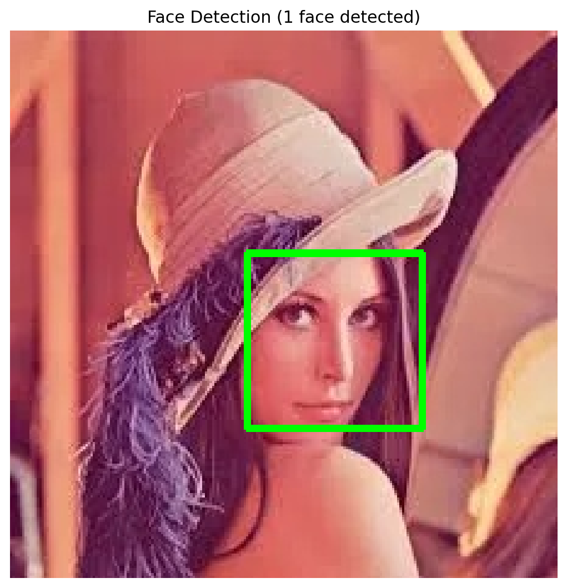
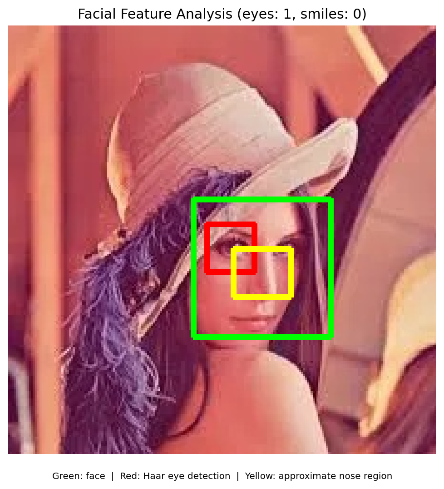
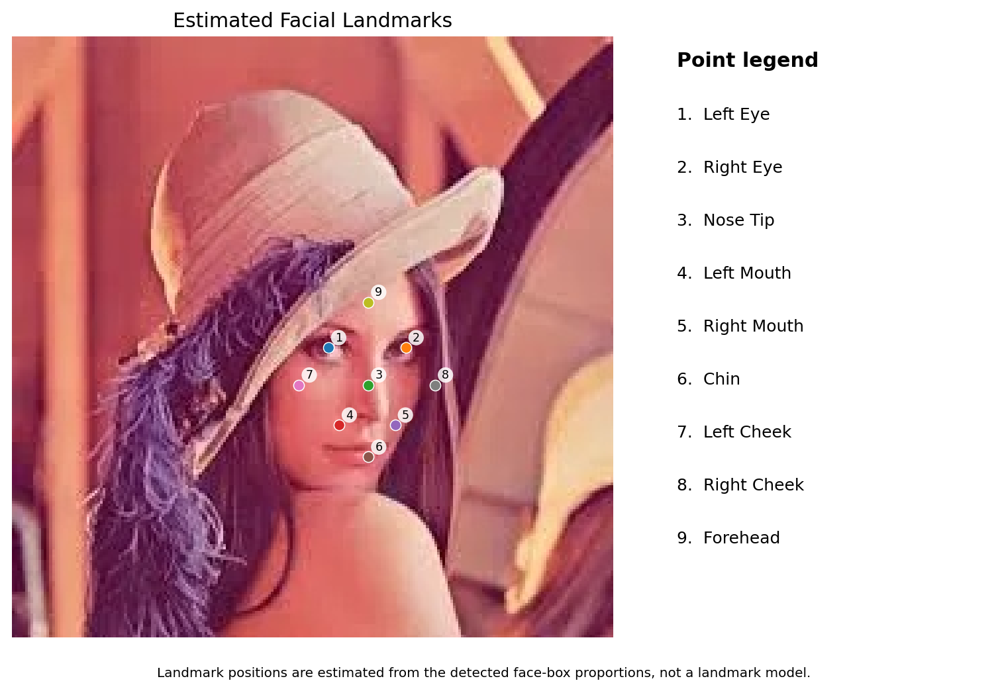
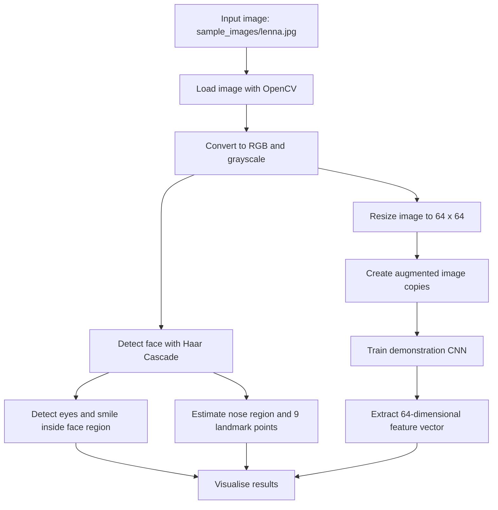

<div align="center">

# Face Detection & CNN Feature Extraction

### A Python computer-vision notebook for face and facial-feature detection, landmark visualisation, and CNN feature extraction.

<p>
  
</p>

<p>
  
  
  
  
</p>

</div>

---

## Overview

This project explores a basic computer-vision pipeline using **OpenCV, TensorFlow, and Python**. It processes an input face image, detects facial regions with Haar Cascade classifiers, visualises approximate facial landmarks, and demonstrates how a convolutional neural network (CNN) can produce a 64-dimensional feature vector.

The complete implementation is available in [`CNN_model_leena.ipynb`](CNN_model_leena.ipynb). The included Lenna image is used as the notebook's sample input.

> **Important:** This is an educational demonstration, not a production-ready facial analysis system. The CNN is trained with randomly generated targets, while the nose and landmark positions are estimated geometrically. The age/gender-style output is based on simple image heuristics and is not a valid or reliable prediction.

## What the project does

| Component | What happens | Method |
|---|---|---|
| Face detection | Finds a face and draws a bounding box | OpenCV Haar Cascade |
| Eye detection | Detects eye regions inside the face region | Haar Cascade |
| Smile detection | Searches the lower face region for a smile | Haar Cascade |
| Nose region | Marks an approximate nose area near the face centre | Geometric estimate |
| Facial landmarks | Marks nine approximate points around facial features | Face-box proportions |
| CNN feature extraction | Processes a resized image and returns a 64-value feature vector | TensorFlow / Keras CNN |
| Image-statistic demo | Calculates saturation and texture values for illustrative labels | HSV + Laplacian variance |

## Visual results

### 1. Face detection

The Haar Cascade face detector identifies a face and draws a bounding box around the detected region.

<p align="center">
  
</p>

### 2. Facial feature detection

The notebook checks for eyes and smiles with Haar Cascade classifiers. The nose area is an approximate region calculated from the face bounding box; it is not detected by a dedicated nose model.

<p align="center">
  
</p>

### 3. Approximate facial landmarks

Nine points are plotted using fixed proportions of the detected face rectangle: left and right eye, nose tip, left and right mouth, chin, left and right cheek, and forehead. These are visual estimates rather than landmarks predicted by a trained landmark model.

<p align="center">
  
</p>

## How it works



### CNN architecture

The Keras Sequential model in the notebook contains:

1. Input layer: `64 × 64 × 3` image
2. Convolutional layer: 32 filters, followed by max pooling
3. Convolutional layer: 64 filters, followed by max pooling
4. Convolutional layer: 128 filters, followed by max pooling
5. Flatten layer
6. Dense layer: 128 units
7. Dense layer: 64 units, used as the feature representation

The notebook creates 100 augmented versions of the sample image using random intensity scaling and horizontal flips, then runs a short five-epoch demonstration. **The target values are randomly generated**, so the training loss and extracted vector should not be interpreted as learned facial classes or validated semantic features. This section illustrates the CNN workflow only.

## Tech stack

- **Python** – notebook implementation
- **OpenCV** – image loading, preprocessing, and Haar Cascade detection
- **TensorFlow / Keras** – CNN model definition, training demonstration, and feature extraction
- **NumPy** – image arrays and augmentation
- **Matplotlib** – result visualisation
- **Jupyter Notebook** – interactive execution

## Project structure

```text
Face-Detection-CNN/
├── CNN_model_leena.ipynb          # Complete implementation
├── requirements.txt               # Python dependencies
├── sample_images/
│   └── lenna.jpg                  # Sample input image
├── outputs/
│   ├── face_detection.png         # Face bounding-box result
│   ├── facial_feature_detection.png
│   └── facial_landmarks.png       # Approximate landmark visualisation
├── .gitignore
└── README.md
```

## Run locally

### 1. Clone the repository

```bash
git clone https://github.com/vrbeirer/Face_Detection_Model_CNN.git
cd Face_Detection_Model_CNN
```

### 2. Create and activate a virtual environment

**Windows (PowerShell):**

```powershell
python -m venv .venv
.\.venv\Scripts\Activate.ps1
```

**macOS / Linux:**

```bash
python3 -m venv .venv
source .venv/bin/activate
```

### 3. Install dependencies

```bash
python -m pip install --upgrade pip
pip install -r requirements.txt
```

### 4. Launch the notebook

```bash
jupyter notebook
```

Open `CNN_model_leena.ipynb` and run the cells from top to bottom. Keep the sample image at `sample_images/lenna.jpg`, because the notebook loads it using that relative path.

> TensorFlow installation can vary by operating system, Python version, and hardware. Refer to the [official TensorFlow installation guide](https://www.tensorflow.org/install) if the dependency does not install in your environment.

## Limitations

- **Single sample:** The repository includes one sample image, so the saved outputs demonstrate only that input.
- **Haar Cascade detection:** Detection quality depends on image conditions, face orientation, and classifier limitations.
- **Estimated geometry:** The nose box and nine landmark points are derived from face-box proportions, not a dedicated landmark detector.
- **CNN training demonstration:** Training uses one source image, augmented copies, and random targets. It does not learn a meaningful facial classification task.
- **Illustrative age/gender heuristics:** Saturation and texture thresholds do not provide reliable age or gender information and should not be used to make decisions about people.

## Possible improvements

- Replace the single-image demonstration with a properly labelled, diverse dataset.
- Train and evaluate a task-specific CNN using meaningful labels and a held-out test set.
- Use a dedicated facial landmark model instead of geometric estimates.
- Add evaluation metrics and test the pipeline on varied images.
- Separate detection, feature extraction, and visualisation into reusable Python modules.

---

<div align="center">

**Built with Python, OpenCV, TensorFlow, and Jupyter Notebook.**

[Repository](https://github.com/vrbeirer/Face_Detection_Model_CNN) · [Open the notebook](CNN_model_leena.ipynb)

</div>
